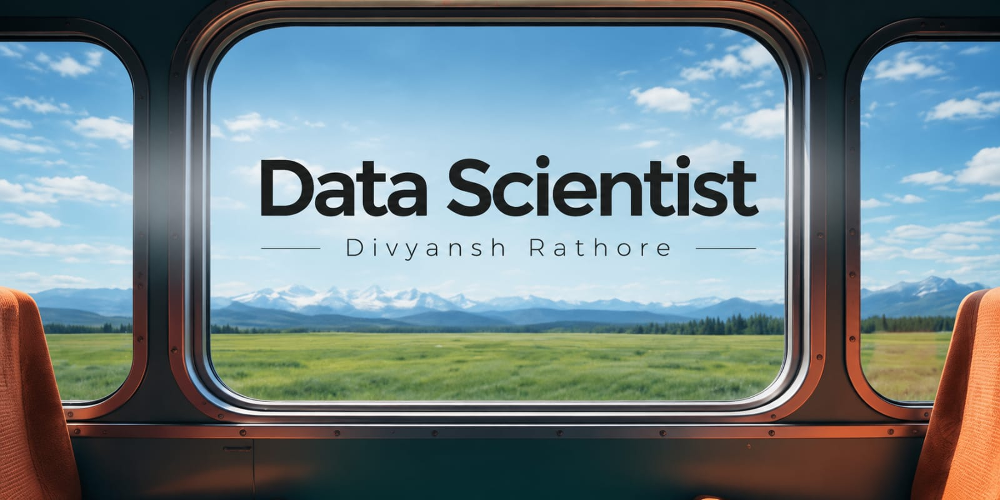

  

<h1 align="center">Hi 👋, I'm Divyansh Rathore</h1>

<h3 align="center">
Aspiring Data Scientist | AI & Data Science Undergraduate
</h3>

  Hey there! I'm a curious mind who loves exploring the world of data and discovering the stories hidden within it. I enjoy building things, breaking things (accidentally, of course), and figuring out how to make them better. When I'm not working with data, you might find me lost in a good book, experimenting with side projects, or wondering why my last bug fix broke everything else. Always learning, always questioning—welcome to my GitHub

---

## 👨‍💻 About Me

* 🎓 B.Tech in Artificial Intelligence & Data Science.
* 📍 Based in Indore, India.
* 🐍 Interested in Python and Data Science.
* How to reach me divyanshrathore278@gmail.com 

---

## 🛠️ Technologies & Tools

* **Languages:** Python, C, C++, SQL
* **Data Analytics:** Power BI, Excel
* **Areas of Interest:** Data Science, AI, Machine Learning

---

<h3 align="center">Let's Connect and Build Something Amazing! 🚀</h3>

